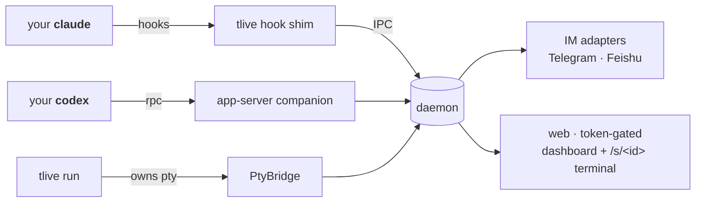

<div align="center">

# tlive

**廠商中立、自架：給 `claude` / `codex` 的遠端核准 + 即時監看層。**
在 Telegram、飛書或網頁終端機上核准工具呼叫、監看執行、接手打字。

[](https://www.npmjs.com/package/tlive)
[](https://github.com/y49/tlive/actions/workflows/ci.yml)
[](LICENSE)
[](https://linux.do)

[English](README.md) · [简体中文](README_CN.md) · [繁體中文](README_ZH_TW.md)

</div>

> 本文件為社群維護的繁體中文翻譯，可能落後於英文原文；內容以 [英文原文](README.md) 為準。

> 你的 `claude` / `codex` 照常在終端機裡跑。tlive 借用兩家都支援的
> **開放 hook 機制**，把狀態（以及你開啟後的核准卡）推送到 **Telegram / 飛書**，
> 並在你自己的機器上提供 **網頁儀表板 + 真實終端機**——在任何裝置上監看、
> 回覆續跑、傳截圖，甚至接手打字。**訂閱或 API key 都能用**；
> 工作階段與資料永遠不離開你的機器。
>
> 開箱即用時 tlive **只監看 + 通知**（`mode: notify`，安全的預設值——它在
> 物理上無法卡住任何工具呼叫）。想開 **遠端核准**——扣住每個工具呼叫，
> 讓你在手機上核准/拒絕——一行指令：**`tlive mode full`**（或讓 `tlive setup` 幫你開）。

> [!WARNING]
> **v2.0 是徹底重寫，breaking，無遷移。** tlive 不再是 v1.x 及更早的 Agent-SDK
> IM *橋接*：它不再驅動/擁有你的工作階段，舊的橋接模型、它的設定 schema、它的
> 指令（`workspace`、`/use`、chat 綁定……）**均已刪除、不再支援**。別把舊的
> `~/.tlive` 設定沿用過來——直接重跑 `tlive setup`。最後一個 SDK-橋接版本保留在
> git tag `v1.0-sdk-bridge`。

**快速跳轉：** [快速開始](#30-秒跑起來) · [兩種整合層級](#兩種整合層級) · [功能一覽](#功能一覽) · [安裝](#安裝走外掛不手改設定) · [Codex 伴隨程式](#codexapp-server-伴隨程式) · [安全模型](#安全模型) · [CLI](#cli) · [設定](#設定tliveconfigjson) · [架構](#架構)

## 30 秒跑起來

```bash
npm install -g tlive

tlive setup        # 精靈：先用 Claude Code / Codex 自己的外掛管理器註冊 tlive
                    # 外掛（hooks、skill、/tlive:* 指令），再問 IM 憑證——也可以
                    # 整段跳過，進 Claude/Codex 裡說「幫我設定 tlive」
tlive start        # 起常駐程式——印出網頁網址 + 手機掃描用的 QR code

tlive run claude   # （可選）包裝工作階段 → 即時網頁終端機 + 預覽卡
```

掃一次 QR code，儀表板就會列出所有工作階段並即時串流每一次執行。開啟遠端核准
（`tlive mode full`）之後，工具呼叫需要核准時，IM 會收到帶 **核准 / 拒絕 /
永遠允許** 按鈕的卡片，網頁卡片同步亮紅。

## 兩種整合層級

| | 只裝 hooks / 伴隨程式（照常跑 `claude`/`codex`） | 包裝（`tlive run claude`/`codex`） |
|---|---|---|
| 核准卡（IM + 網頁） | ✅ | ✅ |
| IM 回覆續跑 | ✅（續跑視窗內） | ✅ |
| 儀表板工作階段卡 | ✅ 狀態 / 最後一句 | ✅ + 即時終端機預覽 |
| 真實網頁終端機（xterm） | — | ✅ 多裝置、手機按鍵列 |
| IM 文字注入（引用回覆 → 打進 pty） | — | ✅ |
| IM 圖片/檔案 → agent | — | ✅（下載後注入路徑） |
| 網頁貼上/拖曳上傳 | — | ✅ |

只裝 hooks 永遠可用，包裝是純加法。表裡的**核准卡**那一列需要開著遠端核准
（`tlive mode full`）；預設的 `notify` 模式把其餘全都做了——即時監看、
一輪結束 / 等待輸入通知、回覆續跑、網頁終端機——卻絕不扣住任何工具呼叫。
IM 訊息帶 `label · ` 前綴（工作階段的目錄名），但不再用圖示區分包裝/只裝
hooks——續跑卡自帶的「回覆以繼續」提示，已經讓這個區分對你實際要做的事沒有影響。

## 功能一覽

- **模式 —— `off` / `notify`（預設）/ `full` / `all`。** 一個坐在所有細旋鈕
  之上的粗開關，按「tlive 攔多少」遞增排列。**`off`** 讓每個 hook 都變成
  no-op（kill switch——不攔截、不通知、不監看、不懶啟動常駐程式）。
  **`notify`**（預設）只監看 + 通知，但 shim 在物理上無法扣住或阻擋任何
  核准——每個提示都保持 100% 原生（你本機的終端機對話框，或無頭時 Claude Code
  自己的自動拒絕）；提示在終端機等你時，通知只送到**這台機器**——桌面通知 +
  儀表板唯讀卡，因為只有坐在機器前的人才能處理它。IM 對這類只有終端機能答的
  對話保持安靜（手機觸不到終端機），每個聊天只有第一次例外：屆時會收到一張卡
  解釋原因，並帶一鍵切到 `full` 的按鈕。桌面通知沒有自己的開關——
  想暫時靜音就用系統內建的「勿擾模式」，想徹底停用 tlive 就 `tlive mode off`。
  **`full`** 為主工作階段開啟遠端核准——這是把核准**送上手機**的模式：
  tlive 扣住每個工具呼叫，讓你在 IM / 桌面 / 儀表板上作答
  （即下方*核准*那條描述的一切），與本機終端機對話框平行競速——先答先得；
  子代理的提示仍照常透傳給終端機。**`all`** 連子代理核准也一併扣住——
  代價是**被扣住的子代理在視窗結束前沒有終端機框**，因為 Claude Code 會先
  等 hook 決定要不要建框——只在沒人守著鍵盤時才划算，`tlive mode full`
  可以切回去。用 `tlive mode off|notify|full|all` 即時切換模式（或在 IM 裡
  送 `/mode`——裸送也會回一張列出階梯並標出當前檔位的卡）；shim 每個 hook 都
  重讀設定，無需重啟也無需新工作階段，`tlive status` 會顯示當前生效的 mode。
  遠端核准設計成 opt-in——剛裝好的工具絕不該能悄悄掛起你的工作流程。
- **核准** *(遠端核准 —— `mode: full` 或 `all`)* —— 需要核准的工具呼叫會被扣住，
  讓你從 IM 按鈕或網頁卡作答：
  - **平行、先答先得** —— Claude Code 上 `PermissionRequest` hook 與本機權限
    對話框平行執行；兩邊都活著，在鍵盤前答掉之後，遠端卡幾秒內自動收尾
    （「已在終端機處理」）。**絕不自動拒絕**——沒人答時本機提示一直有效。
  - **發卡前靜默** —— `approvals.approvalGraceSec`（預設 10 秒，`0` 關閉）先
    扣住卡，鍵盤前馬上答掉就根本不會發出；否則約 24 小時內都可作答。
  - **Codex** —— tlive 接管（adopt/spawn）一個 `codex app-server` 伴隨程式，
    Codex TUI 自動連上；遠端卡與原生提示同樣競速，沒有視窗要設定
    （見[安全模型](#安全模型)）。
  - **呈現** —— diff/指令、高風險樣式標記、金鑰遮蔽。Telegram 卡片克制
    （標題粗體、按鈕純文字；唯一的 emoji 是高風險/錯誤上的 `⚠️`），長 diff 用
    可展開的摺疊——用較新的 Telegram 客戶端呈現最佳。
  - **高風險開關** —— **「永遠允許 \<工具\>」** 按工具放行（記憶體狀態、重啟歸零；
    Claude Code 上會遠端替你點掉原生對話框）；`/trust on|off` 整體暫停核准。
  - **子代理預設透傳** —— 在 `full` 下，tlive 回傳 `{}` 交給 Claude Code 原生處理，
    所以它的終端機框和沒裝 tlive 時完全一樣地彈出。**`tlive mode all`** 連
    子代理核准也一併扣住，但代價是真的：對非同步 agent，Claude Code 會在決定
    要不要建框之前先解析 hook，所以被扣住的子代理在視窗結束前**沒有**
    終端機框——遠端成了唯一答覆路徑。只有沒人守著鍵盤時才划算，
    `tlive mode full` 可以切回去。
  - **無頭執行同樣透傳** —— `claude -p` 和 Agent SDK 程式根本沒有終端機框，
    所以在 `full` 下 tlive 交給 Claude Code 原生處理：`-p` 下直接拒絕，
    SDK 程式走它自己的權限回呼。`tlive mode all` 會扣住它們，被扣住的
    執行會等你作答或等到視窗結束。
- **從 IM 或儀表板回答 `AskUserQuestion`（僅 Claude Code）** —— Claude Code 為自己的
  提問工具 fire `PermissionRequest`；tlive 把它轉成單選或多選卡（核取方塊、即時
  `Submit (N)` 計數、`Skip`）而非核准/拒絕，IM 和儀表板工作階段卡都能答。
  一次呼叫帶多個問題時逐題走：卡標題顯示 `Question 2/3`，`← Back` 可重答
  上一題，答完最後一題才整批回傳。游標歸常駐程式所有，所以在手機上答一題，
  儀表板的卡也跟著推進。本機問題框依舊平行呈現，而且永遠贏下競速——鍵盤前
  給出的答案絕不會被覆蓋；`Skip` 只是放行該工具，讓你在本機答，不是自動核准
  任何操作。Codex 沒有這個概念。
- **續跑** —— `Stop` 時回覆 IM 訊息（或網頁回覆框），工作階段就會繼續。摘錄
  收在摺疊狀態的可展開引用區塊裡（標題、清單、表格、程式碼在展開後都完整保留，
  絕不從詞中間或程式碼區塊中間截斷）；那張卡還掛著時，60 秒後的「等待輸入」
  閒置提醒會被抑制，不會在同一件事上再疊一條訊息。
- **常駐程式懶啟動** —— 只裝 hooks 的工作階段不再需要先手動 `tlive start`：
  `SessionStart` 時 shim（以及 `tlive run` 啟動時）偵測到常駐程式未執行，會
  自動以 detached 方式拉起（不阻塞工作階段）。`daemon.autoStart: false` 可關閉；
  `tlive start` 手動啟動的語意不變。
- **失敗告警（僅 Claude Code）** —— `PostToolUseFailure`（工具呼叫失敗）與
  `StopFailure`（工作階段層級錯誤，如速率限制/帳務）會推一條 `⚠️` 前綴的
  IM 訊息。純旁路，不影響任何核准決策；Codex 沒有對應的 hook，只對 Claude
  Code 生效。
- **工作階段內歡迎提示（僅 Claude Code）** —— IM 還沒設定時，`SessionStart` 會往
  工作階段上下文注入一句提示，引導你說「幫我設定 tlive」；設定好之後就不再出現。
  Codex 不注入。
- **網頁終端機** —— `tlive run <cmd>` 在 `/s/<id>` 提供 pty：xterm.js、多裝置
  **最後輸入決定版面**（誰打字版面歸誰，其他端等比縮放）、晚到客戶端全螢幕重建、
  軟體鍵盤感知版面、觸控查看/輸入雙模式、可拖曳可收起的快速鍵列
  （Esc/Tab/⇧Tab/Ctrl-C/…）、字級調整、複製畫面彈層。
- **儀表板** —— `/` 列出工作階段：狀態徽章、「卡住 Nm」、最後一句、著色核准卡、
  即時終端機預覽、per-session 靜音、📎 上傳、回覆框。
- **餵任何東西給 agent** —— IM 引用回覆文字、IM 圖片/檔案、終端機頁貼上/拖曳、
  儀表板 📎。統一落到 `~/.tlive/inbox`（自動清理：48 小時 / 256MB 總量），
  以 bracketed paste 打進 pty。

## 安裝：走外掛，不手改設定

`tlive setup`（以及 `tlive setup --hooks-only`）不再手改
`~/.claude/settings.json` / `~/.codex/hooks.json`，而是呼叫**各家自己的外掛管理器**：

- Claude Code：`claude plugin marketplace add <內建目錄>`，再
  `claude plugin install tlive@tlive --scope user`。
- Codex（`codex` 在 `PATH` 上時）：`codex plugin marketplace add <內建目錄>`，
  再 `codex plugin add tlive@tlive`。

Claude Code 外掛裡打包了 9 個 hook 事件、一個 `tlive` skill（用法/診斷/
安全模型，掛在 `/tlive:*` 命名空間下），以及 `/tlive:url`、`/tlive:status`
兩個斜線指令。Codex 外掛只帶 skill——Codex 沒有 hook 也不需要，它的整合
方式是 app-server 伴隨程式（見下文）。廠商會把外掛**複製**進自己的
快取（Claude Code 是 `~/.claude/plugins/cache`，Codex 是
`$CODEX_HOME/plugins/cache/tlive/tlive/local/`）——升級 `tlive` 本體之後，
重跑一次 `tlive setup --hooks-only` 更新這份複本。

用過早期直寫 hooks 的開發版？請手動刪一次舊條目（否則會雙發）——見
[docs/manual-hooks.md](docs/manual-hooks.md) 附錄。tlive 本身不再改動你的
廠商設定檔。

**老版本廠商沒有外掛 CLI**：`tlive setup` 會偵測到（`claude plugin list` /
`codex plugin marketplace add` 失敗）並印出指向手動設定附錄的提示：
[docs/manual-hooks.md](docs/manual-hooks.md)——完整的 `settings.json`
hooks 區塊和 `hooks.json`，可以直接拷進去。

解除安裝（`npm uninstall -g tlive`）會盡力用各家 CLI 卸掉外掛，並清理殘留的舊
直寫 hooks；`~/.tlive` 下的設定與日誌保留。完整清理以及**從 v0.x/v1 遷移**
的步驟見 [docs/uninstall.md](docs/uninstall.md)。

**先從 GitHub 直接嘗鮮**（不用等 npm 發布外掛）：`claude plugin marketplace
add y49/tlive`，再 `claude plugin install tlive@tlive`，直接從倉庫根的
`marketplace.json` 拉外掛（hooks/skill/指令）。引擎本體還是要裝：
`npm i -g tlive`——常駐程式/CLI 靠它，hooks 呼叫它。

`tlive setup` 在同時偵測到 `claude` 和 `codex` 都在 `PATH` 上時會問**要裝到
哪**：`[1] Claude Code [2] Codex [3] 都裝（預設）`。外掛註冊永遠先於 IM 憑證
詢問，IM 這步可以整段跳過——直接按 Enter 過掉，之後在 Claude Code 或 Codex 裡說
「幫我設定 tlive」（Claude Code 裡也可直接跑 `/tlive:setup`），AI 會互動式帶你
設完（Codex 沒有斜線指令，說那句話即可）。

## Codex：app-server 伴隨程式

Codex 沒有 hook、也沒有信任這一步——上面 Claude 那套 hooks/信任流程完全
不適用。tlive 改為連上一個 `codex app-server --listen unix://…` 行程：
如果 tlive 的 socket 路徑上已經有一個在監聽就直接 adopt，沒有就起一個
（脫離行程群組，帶 respawn/backoff）。你跑的任何 `codex` TUI 都會**自動連上**
那個 socket——這是 Codex 自身的特性，不是 tlive 每次工作階段去設定的。

因為那個實例是**共用的**，`tlive stop` **不會**把它停掉：它是這台機器上所有
Codex TUI 的會合點，停掉它只會讓那些工作階段繼續跑、但對 tlive 完全不可見。
下一次 `tlive start` 會 adopt 同一個實例，所以重啟 tlive 不再甩掉任何
Codex 工作階段。（這和 Codex 自己的 `codex app-server daemon` 一個思路：一個
脫離的、按 pid 追蹤的 app-server 跨客戶端長活。tlive 沒有直接呼叫它，因為
那條路要求 Codex 的 standalone 託管安裝，npm 裝法上會直接報錯。）

在那條 RPC 連線上，tlive 訂閱 Codex 自己的 thread/turn 事件，並透過
`ServerRequest` 驅動核准：Codex 請求權限決策時，tlive 把同一個請求同時
廣播給 IM/網頁和原生 TUI 提示——**先答先得**，和 Claude Code 的平行通道
語意一致。沒有核准視窗要設定：原生提示永遠不會被 tlive 卡住，因此也沒有什麼
會逾時。

如果伴隨程式連不上（沒裝 Codex、socket 上沒人應答、或者你在 win32 上——
`codex app-server` 那邊還沒接好），`tlive status` 會如實報告；除非 Codex
根本沒裝，tlive 會在背景一直重試——重裝 codex 能自行恢復，Codex 照常走它
自己的本機核准流程——沒有 IM/網頁卡、不會崩，只是少了遠端通道。

## 為什麼不用官方遠端？

官方遠端（Claude Remote Control / Codex 手機端 / Channels）有 tlive 正好補上的
結構性空白：

- **跨 agent** —— 一套設定同時管 Claude Code 和 Codex。
- **API-key 使用者** —— 官方遠端不支援；tlive 不關心你怎麼驗證。
- **自架** —— 鏈路上沒有廠商雲；網頁由單一 token 把關。
- **飛書** —— 官方管道不涵蓋。

tlive 刻意**不做**「手機從零 vibe coding」——官方遠端做得更好。tlive 是給你已經
在跑的工作階段做核准 / 監看 / 插話的那一層。

## 安全模型

- **網頁**：每個 HTTP/WS 請求都要 token（`~/.tlive/web-token`，0600）。預設綁
  `0.0.0.0` 方便手機走區域網路——token 是門。想只留本機，設
  `web.bind: "127.0.0.1"`。**卡片永不攜帶儀表板連結。** 以前的深層連結
  本身就帶著 token——等於完整工作階段控制權——發進 IM 就等於把它永久寄存在
  訊息服務商的伺服器上。想在區域網路外存取就自己開（例如自架
  tailscale/HTTPS 反向代理）；IM 是推送，網頁需要你自己去拉。
- **IM 入站**：fail-closed。非設定 chat 的訊息/按鈕一律丟棄；群組情境可加
  `allowedSenders` 按使用者加固。
- **`/trust on` 與「永遠允許」是高風險開關**：會自動放行。兩者皆為記憶體狀態、
  常駐程式重啟即清。優先使用按工具放行而非 `/trust`。你自己 Claude 設定裡的
  `permissions.deny` 永遠贏——hook 無法越過它。
- **兜底是靜默**：沒設 chat、逾時、常駐程式沒起 → hook 輸出 `{}`，Claude 在
  本機終端機照常提示，就像 tlive 不存在。Claude Code 上本機對話框本來就
  全程活著（平行通道），所以「兜底」只是遠端卡安靜下來而已。
- **Codex 核准天然 fail-safe**——原生提示永遠不會被 tlive 卡住（沒有視窗，
  也就沒有逾時）；伴隨程式連不上時 Codex 就走自己的本機核准流程，`tlive
  status` 會報告 `codex: app-server companion unreachable — approvals
  local-only`。伴隨程式連線正常時，遠端卡和原生提示同場競速——先答先得，和
  Claude Code 的平行通道語意一致。

## CLI

```
tlive setup            精靈 + 註冊廠商外掛（冪等）；--hooks-only 只重裝外掛
tlive start | stop     常駐程式生命週期（stop 冪等）
tlive status           健康狀態、當前生效 mode、網頁網址 + QR、設定路徑
tlive logs [-f]        看常駐程式日誌
tlive run <cmd> …      包裝行程：本機終端機 + 網頁終端機
tlive url              印出儀表板網址 + QR（全螢幕應用蓋住 run 橫幅時用）
tlive mode off|notify|full|all   設定模式（見「功能一覽」）；下一個 hook 即生效
tlive hook <event>     hook shim（Claude Code 呼叫，不是給你用的；
                        Codex 沒有 hook——見 app-server 伴隨程式）
```

`setup`、`start`、`stop`、`status`、`logs`、`run`、`url`、`hook` 是凍結面
（由 `tests/contract/` 鎖定）；`mode` 與執行期開關 `mute | trust | safe`
（`on|off`）是加法指令。

IM 指令：`/mute on|off`（靜音 IM 通知）、`/trust on|off`（暫停核准——全部
自動放行）、`/safe on|off`（自動放行日常操作）、`/mode off|notify|full|all`
（設定模式；裸送 `/mode` 會回階梯卡）、`/help`。在客戶端指令選單裡點一下裸
指令，會回一組 on/off 按鈕而不是報錯。引用任何工作階段訊息回覆 = 打字進那個
工作階段。

## 設定（`~/.tlive/config.json`）

<details>
<summary>完整帶註解設定——所有欄位可選，下為預設值</summary>

```jsonc
{
  // 模式："off" | "notify"（預設）| "full" | "all"（遠端核准，"all" 連子代理
  // 提示也一併扣住——見「功能一覽」）。也可用 `tlive mode …` 或 IM 裡的
  // `/mode` 即時設定；未設 / 未知值都回落 notify。
  "mode": "notify",
  "adapters": {
    "telegram": { "token": "…", "chatIdAllowList": ["123"] },
    "feishu":   { "appId": "…", "appSecret": "…", "chatId": "oc_…" }
  },
  "web": {
    "enabled": true,          // 預設 true
    "bind": "0.0.0.0",        // 預設；只留本機用 127.0.0.1
    "port": 7681
  },
  "daemon": {
    "autoStart": true         // 預設 true；設 false 關閉 session-start 懶啟動
  },
  "approvals": {
    // `holdSubagents` 已刪除 —— 由 `tlive mode all` 取代（如果你的設定裡還有
    // `"holdSubagents": true`：這個鍵現在是死的，會被靜默忽略，想繼續扣住
    // 子代理核准請改用 `tlive mode all`）。
    // 遠端核准視窗（秒），兩家共用。遠端通道與本機提示平行，視窗開長
    // 也不費事——逾時不核准也不拒絕，只是把你逼回鍵盤而已。
    "windowSec": 86200,       // 預設約 24 小時（同時是上限；最小 60）
    // 核准卡發出前的靜默期——鍵盤前這段時間內答掉就永不發卡
    "approvalGraceSec": 10,   // 預設 10 秒，0 = 關閉
    // 多少操作不發卡直接自動放行。不寫（預設）= 一個都不放：Claude Code 原本
    // 會問你的，依然會問你。一旦設定就會**改變 Claude Code 問你什麼** —— 這個
    // hook 只在框即將彈出時才觸發，所以在這裡自動放行 = 抹掉一個你本該看到的
    // 確認框。
    //  不寫（預設）—— 不自動放行任何東西
    //  "readonly" —— 額外放行 Read/Glob/Grep
    //  "safe"     —— 額外放行日常操作（非危險 Bash、非敏感路徑的編輯）；
    //                危險操作（rm -rf/sudo/curl|sh/敏感路徑寫入…）、
    //                MCP/未知工具、AskUserQuestion 仍然發卡
    // 用於自主/agent 驅動情境減少卡量。可用 /safe on|off 即時切換。
    // 絕不越過危險地板——只有 /trust on 才會自動放行危險操作。
    // "autoApprove": "readonly",
    // 一個被扣住的核准在視窗逾時、無人作答時怎麼辦：
    //  "defer"（預設）→ 透傳 {}（回落 Claude Code 原生）；
    //  "deny"        → 帶一句「已逾時」的拒絕，好讓這一輪結束、續跑卡改道 agent。
    // 絕不自動放行。
    "timeoutAction": "defer"
  },
  "allowedSenders": [{ "channel": "telegram", "userId": "42" }]  // 可選
}
```

</details>

## 使用技巧

- **工作階段保活**：tlive 有意不擁有工作階段——`tlive run` 隨終端機結束而結束。
  想要 detach/reattach：`tmux new -s work tlive run claude`。tmux 管保活，
  tlive 管遠端層。
- **手機上捲動**：檢視模式下手指滑動會轉成滾輪事件——全螢幕 TUI（claude）的
  對話區像桌機滑鼠滾輪一樣捲動。看完整歷史用鍵列上的 `Ctrl-R`（transcript）。
- **如何感知被包裝？** 被包裝的行程環境裡有 `TLIVE_SESSION=<id>`（類似
  `$TMUX`）；`tlive run` 在包裝內拒絕巢狀。同一目錄開多個包裝工作階段沒問題——
  各自獨立卡片，包裝內的 hook 流量經 `TLIVE_SESSION` 精確歸屬到對應卡。
- **Windows**：設計上支援（具名管道、ConPTY），但實測少於 Linux/macOS——
  歡迎提 issue。

## 架構



- **常駐程式**不擁有工作階段：只撮合核准/續跑、fan-out pty 位元組、服務網頁。
- **凍結面**（由 `tests/contract/` 鎖定的契約）見 [KERNEL.md](KERNEL.md)。

## 從 v1.0 升級

v1.0 用 Agent SDK 驅動工作階段；v2.0 轉向 hook 層（見
[`docs/changelog-archive.md`](docs/changelog-archive.md)）。Breaking、
無遷移：重跑 `tlive setup`。v1.0 保留在 git tag `v1.0-sdk-bridge`。

## 開發

```bash
git clone https://github.com/y49/tlive
cd tlive
pnpm install
npm run typecheck && npm test && npm run build
```

## 社群

tlive 在 [LINUX DO](https://linux.do) 社群分享與討論，歡迎在那裡回饋和提 bug。

## 授權

MIT，見 [LICENSE](LICENSE)。歡迎提 issue 和 PR——開發環境見上面的[開發](#開發)一節。
